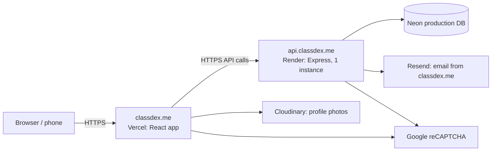

# ClassDex — Production Deployment Guide & Sprint 6.3 Report

**Live Frontend:** `https://classdex.me` (`www.classdex.me` → `308 https://classdex.me/`)  
**Live API:** `https://api.classdex.me`  
**Health Check:** `https://api.classdex.me/api/status`  
**Deployment Date:** `2026-11-12`  

---

## 1. Architecture Overview

### Services & Regions

| Component | Provider | Configuration / Why | Region |
|---|---|---|---|
| **Frontend (`classdex-frontend`)** | **Vercel** (`class-dex`, Hobby) | Vite + React static SPA with edge TLS, SPA rewrites, and security headers ([vercel.json](file:///C:/Users/Acer/Desktop/ClassDex/classdex-frontend/vercel.json)) | Global Edge |
| **Backend (`classdex-backend`)** | **Render** (`classdex-api`, Free) | Node `24.21.0` + Express API, **single instance (`1`)**, `/api/status` health check ([render.yaml](file:///C:/Users/Acer/Desktop/ClassDex/render.yaml)) | **Singapore** |
| **Database** | **Neon** (`ep-still-firefly-ao1zyh81`) | Dedicated empty PostgreSQL production project, completely separate from dev (`ep-polished-night-b3hs4no6`) and test (`ep-orange-dream-b3a6qov0`); 24-hour restore window | **Singapore (`ap-southeast-1`)** |
| **DNS** | **Namecheap** (`BasicDNS`) | Apex & `www` routed to Vercel, `api` CNAME routed to Render, Resend & Email Forwarding records preserved | Global DNS |
| **Transactional Email** | **Resend** | Verified domain `classdex.me`, sender `ClassDex <no-reply@classdex.me>`, SPF + DKIM + DMARC passing | `ap-northeast-1` SES |
| **Profile Photos** | **Cloudinary** (`enllxexd`) | Dedicated unsigned upload preset restricted to `jpg/jpeg/png/webp`, max `5 MB`, folder `classdex/prod-profiles` | CDN |
| **Abuse Protection** | **Google reCAPTCHA v2** | Production Checkbox keys scoped strictly to `classdex.me` and `www.classdex.me` | Global |

> **Single-Instance Requirement (`SEC-22`):** Render is pinned to **exactly `1` instance** (`numInstances: 1`, `WEB_CONCURRENCY=1`). Rate-limiter counters (`express-rate-limit` `MemoryStore`) and email verification resend cooldowns (`verifyResendCooldownByUser`) remain in process memory; scaling horizontally beyond `1` instance requires an external store such as Redis. Express sessions persist in Neon PostgreSQL (`"session"` table via `connect-pg-simple`), so logged-in sessions survive single-instance deploys and sleep wake-ups.

---

## 2. Dashboard Settings & Deployment Order

### Order of Deployment
1. **Neon Production DB:** Create dedicated project in `ap-southeast-1` (`ep-still-firefly-ao1zyh81`) and apply all `20` SQL migrations cleanly once via `node scripts/apply-schema.js` using the **direct** (non-pooled) URL.
2. **Third-Party Consoles:** Create fresh production reCAPTCHA v2 keys (`classdex.me`, `www.classdex.me`), dedicated Cloudinary unsigned preset (`classdex/prod-profiles`, max `5 MB`, image-only), and generate fresh `SESSION_SECRET` (`96` hex chars).
3. **Render Backend (`classdex-api`):**
   - **Root Directory:** `classdex-backend`
   - **Runtime / Node:** `Node` (`"engines": { "node": "24.21.0" }` in [package.json](file:///C:/Users/Acer/Desktop/ClassDex/classdex-backend/package.json))
   - **Build Command:** `npm ci && npx prisma generate`
   - **Start Command:** `node index.js`
   - **Health Check Path:** `/api/status`
   - **Instances:** `1` (`Free`, `Singapore`, `Auto-Deploy: On Commit` from `main`)
   - **Environment Variables:** all names listed in [`ENV_VARIABLES.md`](file:///C:/Users/Acer/Desktop/ClassDex/docs/deployment/ENV_VARIABLES.md) using the **pooled** Neon `DATABASE_URL` and final `https://classdex.me` origins.
4. **Vercel Frontend (`class-dex`):**
   - **Framework Preset:** `Vite`
   - **Root Directory:** `classdex-frontend`
   - **Build Command:** `npm run build` | **Output Directory:** `dist`
   - **Production Branch:** `main` (auto-deploy on push)
   - **Environment Variables (`Production` scope):** `VITE_API_BASE_URL=https://api.classdex.me`, `VITE_RECAPTCHA_SITE_KEY`, `VITE_CLOUDINARY_CLOUD_NAME`, `VITE_CLOUDINARY_UPLOAD_PRESET`.
5. **Namecheap DNS & TLS:** Apply Web/API records documented in [`DNS_RECORDS.md`](file:///C:/Users/Acer/Desktop/ClassDex/docs/deployment/DNS_RECORDS.md) without touching Resend records; set `classdex.me` as primary in Vercel (`www` → `308 classdex.me`).
6. **Live Verification:** Confirm Resend email delivery + SPF/DKIM/DMARC `PASS`, execute [`PRODUCTION_SMOKE_TEST.md`](file:///C:/Users/Acer/Desktop/ClassDex/docs/deployment/PRODUCTION_SMOKE_TEST.md), then switch CSP to enforced `Content-Security-Policy` via `main` and re-verify headers.

---

## 3. Sprint 6.3 Final Report

### A. Jira Ticket Goals & Evidence

| Order | Jira Summary | Status | Evidence |
|---|---|---|---|
| **1** | Set Up Production Database on Neon | **Met** | Dedicated Neon project `ep-still-firefly-ao1zyh81` (`ap-southeast-1`, 24h PITR); `20` migrations applied via `scripts/apply-schema.js` on direct URL; all 18 app/session tables at `0` rows; strict test DB guard rejects both direct and pooled prod hosts (`exit 1`). |
| **2** | Configure Production Environment Variables and URLs | **Met** | All variables inventoried in [`ENV_VARIABLES.md`](file:///C:/Users/Acer/Desktop/ClassDex/docs/deployment/ENV_VARIABLES.md); fresh `SESSION_SECRET` (`96` hex), prod reCAPTCHA v2 keys (`classdex.me`, `www.classdex.me`), restricted Cloudinary preset (`classdex/prod-profiles`, 5 MB, jpg/jpeg/png/webp), final `https://classdex.me` & `https://api.classdex.me` set in Render & Vercel; join links & QR codes verified to use `window.location.origin` (`https://classdex.me`). |
| **3** | Deploy Backend to Render or Railway | **Met** | `classdex-api` live at `https://api.classdex.me` (Singapore, `Node 24.21.0`, `numInstances: 1`, `TRUST_PROXY=1`); `/api/status` → `200`, `/__e2e/*` → `404`, unauthenticated `/api/auth/me` → `401`, Render startup & redacted HTTP logs verified. |
| **4** | Deploy Frontend to Vercel or Netlify | **Met** | `class-dex` live at `https://classdex.me` (`classdex-frontend`, Vite build); SPA deep links return `200 text/html` on hard refresh; security headers active (`HSTS max-age=86400`, `X-Frame-Options: DENY`, `nosniff`, `Referrer-Policy: no-referrer`, CSP rolled out `Report-Only` then switched to enforced `Content-Security-Policy`); 0 `.map` source maps & 0 secrets in bundle. |
| **5** | Connect classdex.me Domain via Namecheap | **Met** | `classdex.me` → Vercel (`216.198.79.1`), `www.classdex.me` → `308 https://classdex.me/`, `api.classdex.me` → `classdex-api.onrender.com`; HTTPS certificates issued on both; HTTP→HTTPS redirects & HSTS verified (`curl -I`); all Resend & forwarding records preserved intact. |
| **6** | Verify Email Sending Domain | **Met** | Real verification, reset, and enrollment decision emails delivered in ~1s from `ClassDex <no-reply@classdex.me>` with `https://classdex.me/...` links; Gmail **Show original** confirmed **SPF `PASS`**, **DKIM `PASS` (`classdex.me`)**, **DMARC `PASS`**. |
| **7** | Run Production Smoke Test and Security Recheck | **Met** *(CSP enforce & cleanup noted)* | Functional smoke test (`A1–A11`) & bounded security recheck (`B1–B7`) recorded in [`PRODUCTION_SMOKE_TEST.md`](file:///C:/Users/Acer/Desktop/ClassDex/docs/deployment/PRODUCTION_SMOKE_TEST.md); 0 Critical/High/Medium/Low `DEP-xx` findings; enforced `Content-Security-Policy` commit staged for Push point 2; smoke-test DB rows intentionally retained by user. |

### B. Resolution of Sprint 6.2 `Deferred to 6.3` Findings & Readiness Items

- **`SEC-22` (In-memory rate limits / resend cooldowns):** Pinned Render service to **1 instance** (`render.yaml` `numInstances: 1`, `WEB_CONCURRENCY=1`) and documented single-instance constraint.
- **`SEC-24` (Session persistence & cookie flags):** Replaced `MemoryStore` with **Neon PostgreSQL session store (`connect-pg-simple`)** via migration `20261112010000_add_session_table`, reusing the `pg.Pool` from `db.js` with `ClassDex` session cookies set to `HttpOnly; Secure; SameSite=Lax`; verified surviving Render restart (`A10`).
- **`SEC-26` (Host security headers, HSTS, CSP):** Added Helmet headers + production HSTS on backend (`api.classdex.me`) and `Strict-Transport-Security: max-age=86400`, `X-Frame-Options: DENY`, `X-Content-Type-Options: nosniff`, `Referrer-Policy: no-referrer`, and `Content-Security-Policy` on Vercel (`classdex.me`).
- **Additional Gate 0 Hardening:** Tightened test DB guard to an allowlist of `ep-orange-dream-b3a6qov0`, added `pg.Pool` idle error handler + read-only cold-start retry (`db.js`), enforced `0.0.0.0` bind & redacted HTTP logging (`index.js`), and added production build-time rejection of Google's public reCAPTCHA test keys (`vite.config.js`).

### C. Remaining Risks & Operational Notes

1. **Single Backend Instance (`SEC-22`):** In-memory `express-rate-limit` counters and `verifyResendCooldownByUser` reset on restart and forbid horizontal scaling without adding Redis.
2. **Render Free Tier Sleep & Logs:** Service sleeps after **15 minutes** idle (~30–60s cold-start on next request; use pre-presentation warm-up in [`RUNBOOK.md`](file:///C:/Users/Acer/Desktop/ClassDex/docs/deployment/RUNBOOK.md)) and keeps logs for **7 days**.
3. **Resend Free Plan Cap:** ~100 emails/day limit; avoid sending to fake addresses that create bounces.
4. **Accepted Risk (`SEC-07`):** Public self-registration still allows selecting `FACULTY` role (carried over as `Accepted risk` from Sprint 6.2).
5. **HSTS `max-age` (`86400`):** Intentionally kept at 1 day without `includeSubDomains` / `preload` during initial rollout; raise to `31536000` after extended stability.
6. **Sub-flows Not Exercised in Manual Pass & Retained Test Data:** Student List upload/paste, roster-match auto-approve, faculty Decline flow, and Projects/Late/Absent sub-controls were `Not Run` in this manual pass (`PRODUCTION_SMOKE_TEST.md`); the 4 smoke-test users (`0` `qa_` users) and sample class `IT-111/111L` (`FWG4QA`) were retained by owner choice and can be wiped anytime using the targeted SQL in `PRODUCTION_SMOKE_TEST.md`.

### D. Repository Compliance Confirmations

- **Zero Secrets in Repo/Docs:** Only environment variable names, placeholders, and public targets appear in code, config files, and `docs/deployment/`.
- **Production Safety:** Automated test suites (`test:api`, `test:e2e`, `test:security`), seed scripts, and cleanup scripts were **never** executed against the production DB or live URLs.
- **Git Control:** Every ticket was developed on its own feature branch off `sprint-6-3` and merged locally `--no-ff`.
